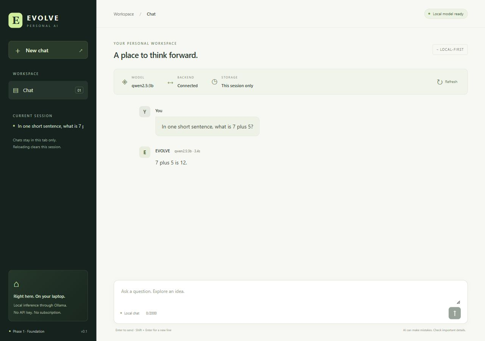
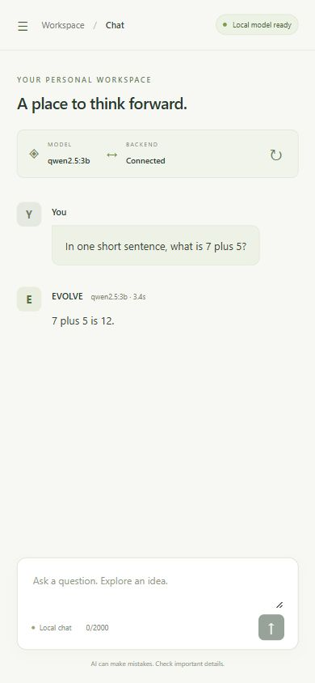

# Phase 1 acceptance results

Checked on **10 October 2026**, Windows PowerShell, in `D:\evolve ai`. Phase 1 is implemented and its acceptance criteria have been checked. Phase 2 has not been started.

## Acceptance checklist

| Criterion from the brief | Observed result |
| --- | --- |
| Inspect and preserve existing work | Initially only the 14,891-byte brief existed; no implementation, manifests, or Git repository. The brief's SHA-256 stayed unchanged. |
| Backend starts with documented Windows commands | Created `backend/.venv` with Python 3.13 and installed requirements. Uvicorn started successfully at `127.0.0.1:8000` with the README command. |
| `GET /health` gives real health | Live HTTP request returned `{"status":"ok","service":"evolve-backend","phase":1}`. |
| Ollama connectivity and installed-model status | Live `/model-status` returned `status: ready`, `ollama_reachable: true`, `model_available: true`, `model: qwen2.5:3b`, `base_url: http://localhost:11434`. |
| Frontend starts and sends to backend | Vite started at `127.0.0.1:5173`. Its `/api/health` proxy returned the live FastAPI health response. A browser chat submission completed successfully. |
| Backend returns real local inference | Opt-in integration test used the real Ollama HTTP API and returned `2 plus 2 is 4.`; the first test took 12,093 ms, the final suite's inference took 4,499 ms. |
| Website receives real local inference | Browser sent `In one short sentence, what is 7 plus 5?` and displayed `7 plus 5 is 12.` with `qwen2.5:3b` and about 3.4 seconds elapsed. |
| Clear errors when Ollama/model is unavailable | Offline contract tests passed for unreachable Ollama, missing models, malformed upstream responses, inference timeouts, HTTP errors, request limits, validation, and busy generation. Error results contain actionable messages, never AI answer text. These error scenarios used test-only transport fixtures; the successful inference checks used real Ollama. |
| No paid API or extra model | Inference calls only local Ollama. No API key, paid API, fallback switch, cloud model, or model download was used. |
| Basic backend tests pass | Final complete run: **48 passed**, including the real integration test, in 6.54 seconds. |
| README explains setup/run | README contains Python environment setup, npm installation, two-terminal PowerShell startup, configuration, manual endpoint checks, tests, and build/preview commands. |
| No mock answer presented as real | Production chat goes through FastAPI to `/api/chat` on local Ollama. Fixtures exist only under `backend/tests`. No canned assistant answer is in the UI. |

Preserved brief SHA-256: `B94C88D2C1C42C11D0DF3B13DB24C275E9CB58FE35BA1FFF2B16BB614230EBD1`.

## Executed checks

Commands below were actually executed, using the project virtual environment for backend tests.

| Command/check | Actual result |
| --- | --- |
| `ollama --version`; `ollama list`; live `/api/tags` | Ollama 0.40.1; qwen2.5:3b and tinyllama:latest already installed |
| `py -3.13 -m venv .venv` | Succeeded |
| `.\.venv\Scripts\python.exe -m pip install -r requirements-dev.txt` | Succeeded in the isolated environment |
| `.\.venv\Scripts\python.exe -m pytest -q` | 47 passed, 1 intentionally skipped integration test, 1 warning |
| `$env:EVOLVE_RUN_OLLAMA_TEST = '1'`; `.\.venv\Scripts\python.exe -m pytest -q -s -m integration` | 1 real inference test passed; 47 deselected; 1 warning |
| Same opt-in variable; `.\.venv\Scripts\python.exe -m pytest -q -s` | **48 passed**, 1 warning; real Ollama response printed |
| `.\.venv\Scripts\python.exe -m pip check` | No broken requirements found |
| `python -m ruff check backend/app backend/tests` | All checks passed, using the preinstalled development tool |
| `npm install` | Succeeded; npm package-lock generated |
| `npm run typecheck` | Passed on final code |
| `npm run build` | Passed on final code; Vite 8.3.4 built 17 modules in 380 ms; JavaScript ~230.48 kB (72.15 kB gzip), CSS ~11.96 kB (3.55 kB gzip) |
| `npm ls --depth=0` | React/React DOM 19.3.0, Vite 8.3.4, TypeScript 7.0.2, React plugin 6.1.2, React/DOM types 19.3.0, Node types 24.19.2 |
| `npm audit --audit-level=high` | 0 vulnerabilities reported at check time |
| Live browser console after chat | No warnings or errors observed |
| Responsive desktop at 1280 × 900 | Real chat answer visible, sidebar and composer rendered; document width 1280 px |
| Responsive mobile at 390 × 844 | Real chat answer visible, drawer opens/closes, hidden navigation removed from the accessibility tree; document width 390 px (no horizontal overflow) |

The initial TypeScript check failed because a CSS side-effect import lacked Vite's client type declaration. Adding `src/vite-env.d.ts` fixed it; the subsequent typecheck and production builds passed. The responsive check also identified an obscured mobile drawer-close target; its hit area and hidden-sidebar visibility were corrected and rechecked.

One remaining **nonblocking dependency warning** appears during pytest: Starlette 1.7.0 deprecates using HTTPX with its TestClient in favor of HTTPX2. The current HTTPX 0.28.1 test path works and all tests pass. No warning was suppressed. The runtime Ollama client remains HTTPX; this warning concerns the test harness.

## Screenshots of real execution

## Remaining scope

Phase 1 uses non-streaming inference and temporary browser-memory conversation state. CPU latency varies. There is no tool execution, persistence, upload support, or self-development. The next authorized milestone would be Phase 2: a validated tool-calling loop, calculator, CSV analysis, iteration limits, and tool tests. It has not been implemented.
