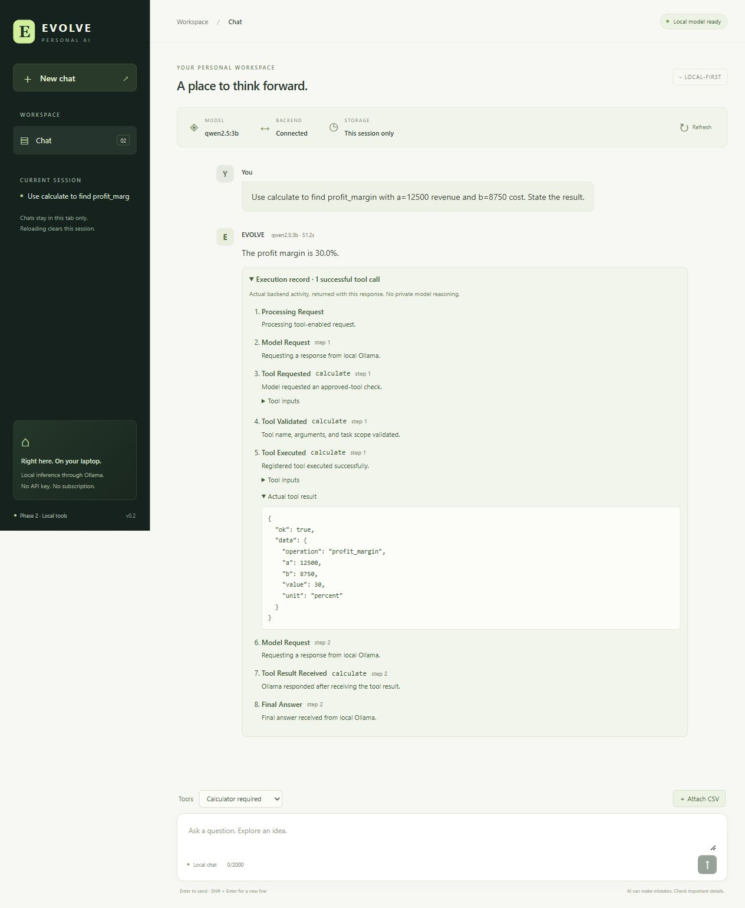
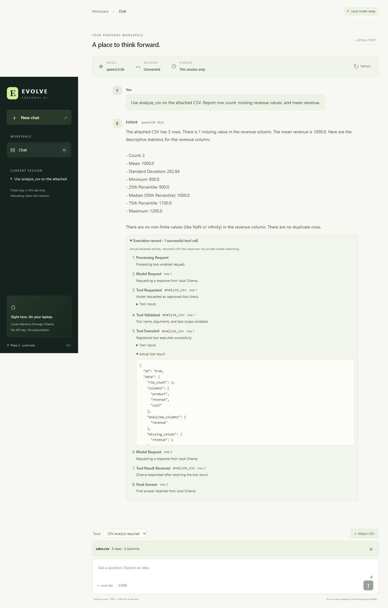
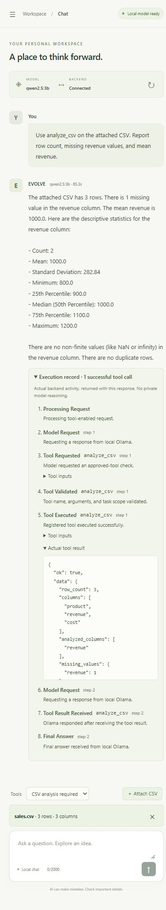

# Phase 2 acceptance results

Checked on **10 October 2026**, in Windows PowerShell at `D:\evolve ai`. Phase 2 is implemented. Phase 3 and Phase 4 have not been started.

## Inspection and preservation

Read the authoritative project brief, the attached Phase 2 request, existing backend/frontend source, configuration, README, and tests before editing. The existing app had `GET /health`, `GET /model-status`, and `POST /chat`; inference used HTTPX to call local Ollama with non-streaming JSON responses. The UI used Vite's local `/api` proxy. There was no persistence or tool execution. Baseline: **47 offline tests passed**, 1 opt-in integration test skipped, and frontend typecheck passed.

The original brief and historical Phase 1 validation report remain unchanged. Brief SHA-256: `B94C88D2C1C42C11D0DF3B13DB24C275E9CB58FE35BA1FFF2B16BB614230EBD1`. Existing endpoints, local model defaults, plain-chat fields, request limits, and UI design were retained. Health metadata now reports phase 2, with the corresponding regression assertion updated. Existing clients omit `use_tools` to retain plain chat.

## Installed Ollama schema confirmed

Ollama **0.40.1** was already installed and reachable. `qwen2.5:3b` and `tinyllama:latest` were present; no models were downloaded or switched.

A direct live request asking the model to add 17 and 25 returned an assistant message with empty `content` and native `tool_calls`. The observed call contained `id: call_algj4o7i`, `function.index: 0`, `function.name: calculate`, and object arguments `{b: 25, operation: add, a: 17}`. The envelope had `done: true` and `done_reason: stop`. The loop supports this installed format and preserves native metadata. It does not parse printed JSON/Python as an executable tool request. Protocol references: [Ollama chat API](https://docs.ollama.com/api/chat), [Ollama tool calling](https://docs.ollama.com/capabilities/tool-calling).

## Acceptance criteria

| Criterion | Verified evidence |
| --- | --- |
| Phase 1 behavior remains functional | All 47 existing offline tests pass after updating the health phase number. Real plain-chat integration also passed. Live health and model status are healthy. |
| Model requests an approved tool | Real calculator and CSV integration tests received native calls from qwen2.5:3b. Both also worked from the website. |
| Backend validates and executes the tool | Explicit registry, strict numeric/schema validation, whole-batch validation before execution, and task/upload scope checks. Deterministic tests cover rejection paths. |
| Actual results return to the model | Both real cycles contain `tool_executed → model_request → tool_result_received → final_answer`. Deterministic transport tests additionally inspect the second request's actual tool-result JSON. |
| At least one full tool cycle works | Both calculator and CSV cycles completed through real Ollama, in integration tests and through the browser. |
| Calculator verified | Profit margin for revenue 12500 and cost 8750 returned **30 percent**. Tests also verify arithmetic, profit, percentage change, zero denominators, invalid types, and overflow. |
| CSV analysis verified | Known CSV returned **3 rows**, **1 missing revenue value**, mean revenue **1000**, and revenue sum **2000**. Unit tests cover missing values, selected/invalid columns, malformed content, headers, encoding, nonfinite values, limits, and JSON-safe statistics. |
| Genuine website activity | Browser expanded actual execution records showing calls, validation, registered execution, exact JSON tool results, Ollama's response after receiving results, and the final answer. No thoughts or fabricated progress appeared. |
| Invalid requests and safe stopping | Tests passed for unknown tools, extra/invalid arguments, malformed responses, missing/unattached/cross-task uploads, path traversal, oversize data, iteration/call/repetition limits, request timeouts, and total task deadlines. |
| Tests/typecheck/build pass | **132 offline tests passed**; **3 real integration tests passed**; TypeScript and production build passed. |
| Documentation current | README includes Phase 2 architecture, API examples, tool semantics, CSV upload flow, PowerShell commands, configuration, retention, limits, and test instructions. |

## Actual test runs and checks

- `backend/.venv/Scripts/python.exe -m pytest -q`: **132 passed, 3 skipped, 1 warning**. The three skips are the intentionally opt-in real Ollama tests. Final offline run took 9.62 seconds while other local verification was running.
- With `EVOLVE_RUN_OLLAMA_TEST=1`, `backend/.venv/Scripts/python.exe -m pytest -q -s -m integration`: **3 passed, 132 deselected, 1 warning**, in 60.97 seconds. No mocked transport was used in these tests.
- Real plain-chat response: `2 plus 2 is 4.` (10,241 ms).
- Real calculator cycle: `The profit margin is 30.0%.` (19,029 ms); actual tool data independently asserted to equal 30.
- Real CSV cycle: reported 3 rows, 1 missing revenue value, and mean revenue 1000 (29,513 ms); the test independently asserted those tool values and the return-to-model event.
- `npm run typecheck` and `npm run build`: passed. The final build includes 18 modules, approximately 234.46 kB JavaScript (73.44 kB gzip) and 13.65 kB CSS (3.90 kB gzip), built in 284 ms.
- `backend/.venv/Scripts/python.exe -m pip check`: no broken requirements found.
- `python -m ruff check backend/app backend/tests`: all checks passed, using the preinstalled development tool.
- `npm audit --audit-level=high`: 0 vulnerabilities reported at check time.
- Live `GET /health`: `status: ok`, `service: evolve-backend`, `phase: 2`.
- Live `GET /model-status`: `ready`, reachable true, selected model available true, `qwen2.5:3b`.
- Live Vite `/api/tools` proxy: returned both installed tools and the configured CSV limits.
- Documented `curl.exe` multipart upload command: succeeded with the sample, returning 3 rows and column names product/revenue/cost.
- Original brief hash: unchanged.

One test initially expected every drive-prefixed multipart filename to be rejected. The actual multipart parser normalizes browser-style Windows paths to the basename. The test was corrected to verify that normalization and generated storage names; direct storage path rejection, relative traversal rejection, tampered record paths, and resolved directory escape checks are separately tested. No caller filename is ever used as a storage path.

One existing **nonblocking Starlette warning** remains: Starlette's TestClient deprecates HTTPX compatibility in favor of HTTPX2. All tests pass with the existing HTTPX client. The warning was not suppressed.

## Browser verification

Both runs used the real frontend, Vite proxy, FastAPI server, tool registry, and local qwen2.5:3b:

- **Calculator required:** model requested profit_margin, the backend executed it with a=12500/b=8750, the displayed JSON result was 30 percent, and Ollama answered 30.0%. Observed browser task duration: about 51.2 seconds.
- **CSV upload and analysis:** uploaded `examples/sales.csv` through the file chooser; the UI showed the actual 3-row/3-column metadata and selected CSV-required mode. The model called analyze_csv for revenue, the execution record showed the correct statistics, and the final answer reported them. Observed browser task duration: about 65.3 seconds.
- Desktop layout checked at 1280 × 900. Mobile layout with expanded execution records checked at 390 × 844; measured document width was 375 px within the 390 px viewport, with no horizontal overflow.
- Browser console: no warnings or errors observed after both tool flows.
- A new-chat state issue found during review was fixed: starting a new chat clears the attachment and resets tool selection to Auto, preventing an unattached CSV-required request.

## Changed files and boundaries

Added `backend/app/agent`, `backend/app/tools`, `backend/app/uploads.py`, deterministic tool/agent/upload tests, two new real integration tests, `frontend/src/components/ActivityLog.tsx`, a sample CSV, and this report. Extended the existing API, schemas, configuration, UI/API client/CSS, environment example, dependency files/lock, and README. No frontend dependency was added. Backend additions are pandas and python-multipart plus their resolved dependencies.

Execution records arrive with the completed response, not as a live stream. Conversations and upload-handle associations remain temporary; uploads stay in the local workspace until manually removed and must be re-uploaded after backend restart. Model interpretation can still be wrong, and finite context limits can affect large summaries. Tools are fixed, bounded Python functions; no generated code or arbitrary filesystem/shell access is available. No SQLite memory, RAG, candidate generation, self-modification, model training, or Phase 3/4 work was implemented.
