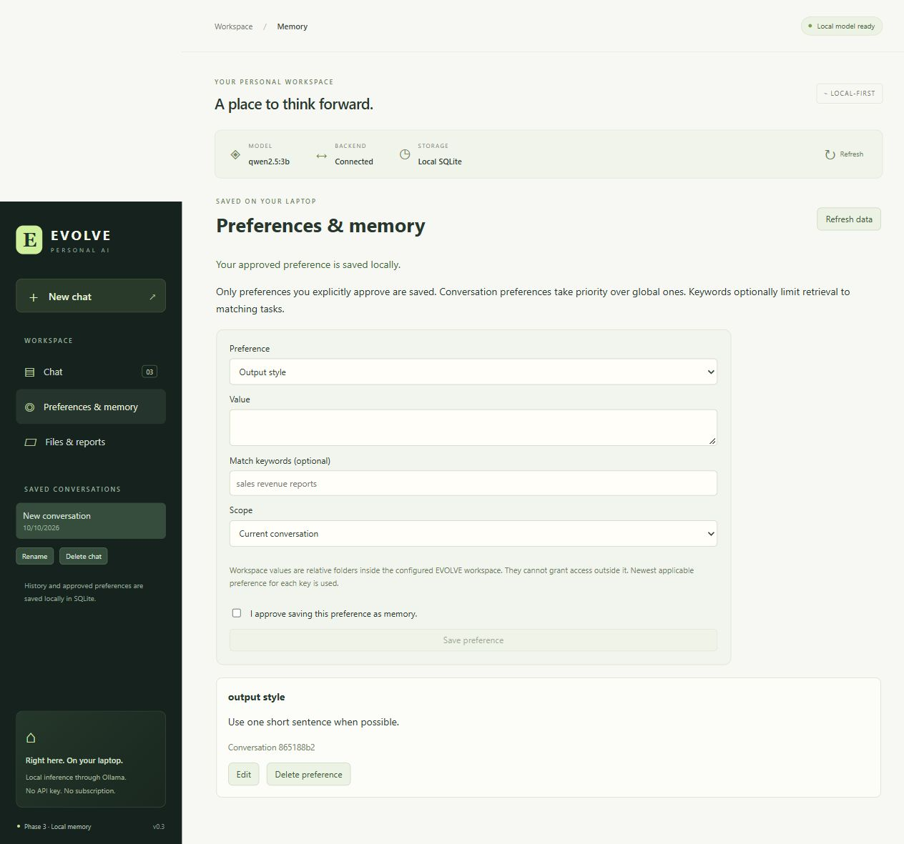
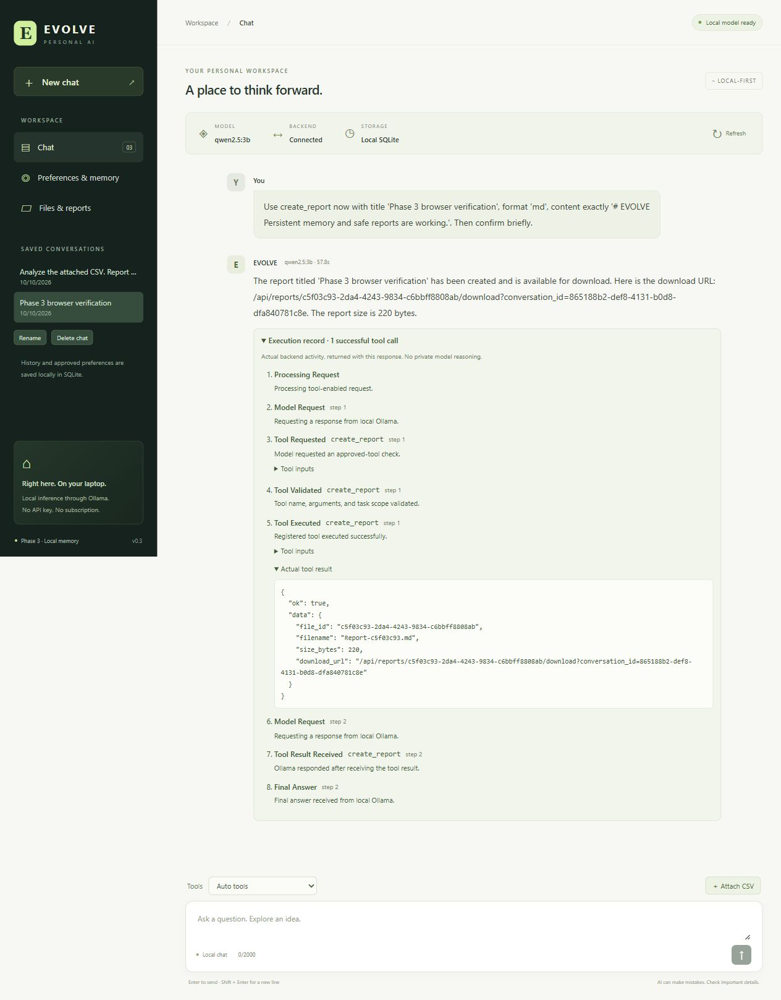
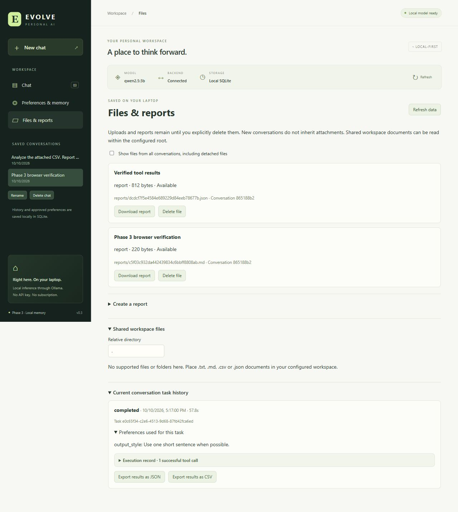
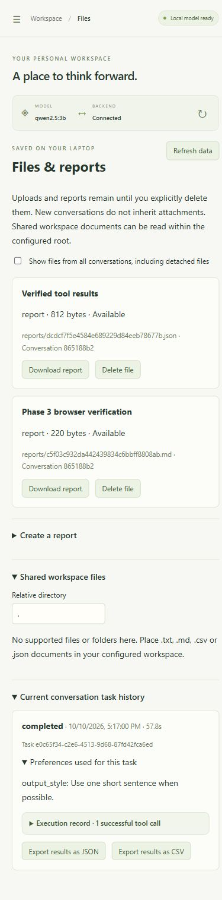
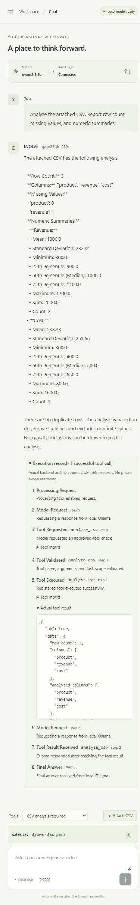

# Phase 3 acceptance results

Checked on **10 October 2026**, Windows PowerShell, in `D:\evolve ai`. Phase 3 implements local persistent memory and workspace automation. Phase 4 has not been started.

## Inspection and preservation

Read the complete authoritative project brief, Phase 3 attachment, README and historical Phase 1/2 reports before changing code. Inspected configuration, schemas, API contracts, the agent loop/registry, upload storage, frontend state and tests. Baseline was the existing React/Vite/TypeScript and FastAPI app with real local Ollama, calculator/CSV tools and nonpersistent execution records. The baseline run passed **132 offline tests**, with 3 opt-in tests skipped.

Existing runtime dependencies and lockfiles were retained. SQLite uses Python's standard library. No model, paid API, ORM, vector store or frontend UI library was added. Existing workspace files were preserved; no old upload was guessed into a conversation. Original brief SHA-256 remains `B94C88D2C1C42C11D0DF3B13DB24C275E9CB58FE35BA1FFF2B16BB614230EBD1`. Historical Phase 1/2 reports remain unchanged.

## Acceptance checks

| Requirement | Actual evidence |
| --- | --- |
| SQLite initialization and upgrades | Transactional versioned migrations, foreign keys, WAL, parameterized writes and indexes. Tests preserve version-1 conversation data through version-2 migration, repeat initialization safely, reject unknown newer versions, and roll back invalid task/file writes. Live database integrity and foreign-key checks passed. |
| Conversations survive restart | Offline tests start a second app on the same database, verify ordered messages/title/task records, and continue with server-owned history. Real integration recalls MAPLE-73 after an app restart. Browser conversation restored after stopping/restarting the Uvicorn process. |
| Bounded context and isolation | Configurable recent-message/character limits; tests reject forged client history and verify another conversation's messages/preferences are absent. New conversation resets attachment, tool selection and task ID. |
| Task/events/results persist | Events are written as the existing loop executes. Final response/status/time are transactional. Tests cover ordered successful events/results, failure status, completed_with_errors, duplicate task rejection and interrupted-task recovery. Browser shows real saved activity and preference snapshots. |
| Explicit preferences | Approved-only API and unchecked-by-default approval form, create/list/edit/delete, global/scoped records, lightweight keyword matching and a memory budget. Tests inspect the actual Ollama request for correct scope, relevance and priority. The model has no preference-writing tool. |
| Persistent uploads | Generated paths and SQLite metadata, stable UUIDs, conversation ownership and task_files links. Tests analyze a saved CSV in a new task after restart, reject cross-conversation use, and handle missing files/cleanup. Browser uploaded the sample, restarted FastAPI, then attached its saved handle again. |
| Confined workspace automation | Fixed list/read/report tools; small UTF-8 txt/md/csv/json support. Tests reject traversal, drive/UNC/ADS paths, resolved escape, symlinks/junctions, unsupported/binary/oversized content, and tampered managed paths. Shared user documents are deliberately separate from conversation-owned uploads/reports. |
| Reports and exports | Tests create all four report formats, verify exact download content, ownership, generated names/no overwrite, invalid/missing references and capacity limits. JSON/CSV export reads persisted tool results directly. Real Ollama created and downloaded a text report; browser created/downloaded Markdown and exported verified results as JSON. |
| History/deletion controls | UI has saved conversation selection, rename, scoped/global preferences, files/reports, task history and loading/empty/errors. Accessible confirmation dialogs precede deletion. Offline tests verify confirm=true enforcement, removal of scoped history, retention of detached files, and explicit cleanup. Browser rename succeeded and conversation deletion was cancelled. |
| Preserve Phase 1/2 | Existing offline regressions pass. Real plain chat, calculator and CSV cycles all pass using qwen2.5:3b. Legacy chat requests remain supported and workspace tools require a saved conversation. |
| Local model and scope | Existing Ollama 0.40.1 and qwen2.5:3b used. tinyllama was present but never selected. No models downloaded. Five fixed tools; no generated code, shell, self-modification, fine-tuning or Phase 4 work. |

## Executed checks

| Command/check | Actual result |
| --- | --- |
| `backend/.venv/Scripts/python.exe -m pytest -q` | Final run: **155 passed, 4 skipped, 1 warning**, 11.00 seconds. Skips are the explicitly opt-in Ollama tests. |
| With EVOLVE_RUN_OLLAMA_TEST=1: `backend/.venv/Scripts/python.exe -m pytest -q -s -m integration` | **4 passed, 150 deselected, 1 warning**, 155.81 seconds. This run preceded five additional offline tests; all 155 offline tests subsequently passed. |
| `npm run typecheck` | Passed on final frontend source. |
| `npm run build` | Passed, 20 modules, 341 ms; JavaScript 250.34 kB (77.44 kB gzip), CSS 17.21 kB (4.67 kB gzip). |
| `python -m ruff check backend/app backend/tests` | All checks passed using the installed development tool. |
| `python -m black --check backend/app backend/tests` | Passed; 22 files unchanged. |
| `npm exec --yes --package=prettier -- prettier --check src` | All frontend source matched formatting. |
| `backend/.venv/Scripts/python.exe -m pip check` | No broken requirements found. |
| `npm audit --audit-level=high` | 0 vulnerabilities reported at check time. |
| Live health, model-status and Vite tools proxy | Phase 3 backend healthy; qwen2.5:3b ready; all five approved tools returned. |
| SQLite PRAGMA user_version / integrity_check / foreign_key_check | Version 2, integrity ok, no foreign-key errors. |
| Original brief hash | Unchanged. |

Real integration evidence:

- Plain chat: `2 plus 2 is 4.` (11,403 ms).
- Calculator: verified profit margin **30 percent** (19,046 ms), with a model → tool → model cycle.
- CSV: verified **3 rows**, **1 missing revenue value**, mean revenue **1000** (46,239 ms), with actual results returned to Ollama.
- Restarted conversation: `You shared that your project code is MAPLE-73.`
- Required create_report cycle: successful tool execution, returned result received by Ollama, final confirmation (68,046 ms). Downloaded file contained `Project code: MAPLE-73`.

One existing nonblocking Starlette warning remains: TestClient's HTTPX compatibility is deprecated in favor of HTTPX2. All tests pass using the installed HTTPX stack; no warning was suppressed. There is no frontend unit-test runner; frontend verification combines TypeScript, formatting, build and actual browser actions.

## Browser verification

Used the real frontend/Vite proxy, restarted FastAPI server, SQLite and local qwen2.5:3b. A scoped preference was explicitly approved through the form. A required report request completed in **57.8 seconds**, showing the actual create_report execution/result and stored preference snapshot. Its Markdown download succeeded, and verified tool-result JSON export created another registered report. Both reports and the conversation/task remained after stopping and restarting Uvicorn. Rename succeeded using an accessible dialog; opening and cancelling conversation deletion preserved the records.

Desktop was checked at 1280 × 900. The files/task view was also checked at 390 × 844; measured document width was 375 px, within the viewport. Mobile navigation and a new empty conversation were verified. The sample CSV was uploaded in that new conversation, the backend restarted, and its saved handle was attached through Files & reports without re-uploading. A real subsequent CSV task completed in **95.9 seconds**, with 3 rows, one missing revenue value, revenue mean 1000 and sum 2000, and cost sum 1600. Switching back to the report conversation cleared the CSV attachment (zero attachment controls present).

The in-app browser rejected the initial native prompt() rename control. It was replaced with accessible in-app rename and deletion dialogs, including focus handling, Escape/cancel and confirmation buttons. Rename and cancellation then worked. Console inspection showed that one historical pre-fix prompt error and no additional warnings/errors during the corrected flows.

The model added extra boilerplate to the browser's Markdown content despite an exact-text request. This is a model instruction-following limitation, not a fabricated execution: the actual 220-byte file and tool inputs/results are inspectable. The integration text report did contain the requested project code. Use direct verified-result exports for exact tool data, and inspect model-authored reports.

## Files changed

Added backend `app/storage.py`, `app/api.py`, `app/tools/workspace_files.py`, isolated test storage in `tests/conftest.py`, and `tests/test_persistence.py`. Extended main/config/schemas, persistent uploads, registry/loop context and event persistence, chat-only context, existing phase assertions/catalog checks and real integration coverage. Added frontend PersonalData/DataDialog components and extended App/API/CSS. Updated `.env.example`, `.gitignore`, README and this report; added actual browser screenshots. Runtime dependency manifests/lockfiles were not changed.

## Schema and retention

Schema v1: conversations, messages (global ordered seq plus stable UUID), tasks, ordered events with validated JSON and preference records. Schema v2: files with generated relative paths/metadata and task_files associations. Tasks store explicit preference snapshots, final model/duration/status/error and UTC timestamps. Reports are file records of kind report; manually created reports need not have a model task. Migrations run automatically at startup without deleting old data. Running tasks become interrupted after restart and retain any already-recorded activity.

No automatic deletion occurs. Confirmed conversation deletion removes scoped history/preferences but retains files as detached metadata. Confirmed file cleanup removes only the registered generated file and metadata; historical task results remain. Deleting a preference stops future retrieval but leaves historical task snapshots until conversation deletion. Old Phase 2 files remain on disk and require deliberate re-upload because their ownership metadata never existed.

Startup, backup, migration and retention PowerShell instructions are in [README.md](README.md). Start FastAPI with `.\.venv\Scripts\python.exe -m uvicorn app.main:app --host 127.0.0.1 --port 8000` from backend; start Vite with `npm run dev` from frontend. Keep one backend worker. Back up both data and workspace while the backend is stopped; never delete the database to upgrade.

Limits: single-user loopback access, plaintext local storage/backups, bounded recent context/list views, non-streaming responses and variable CPU latency. Shared documents deliberately placed in the configured root are accessible across conversations; managed uploads/reports require their owning context. No vectors, semantic-history retrieval, Excel parsing or arbitrary filesystem operations. Phase 4 remains outside this implementation.
