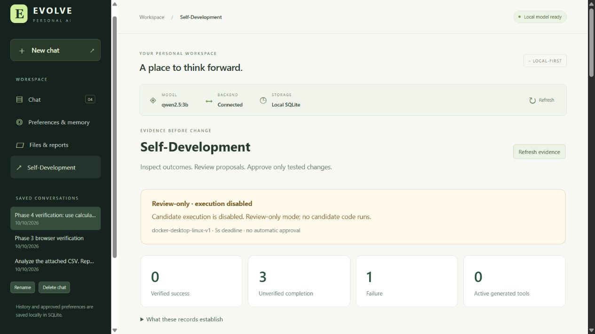
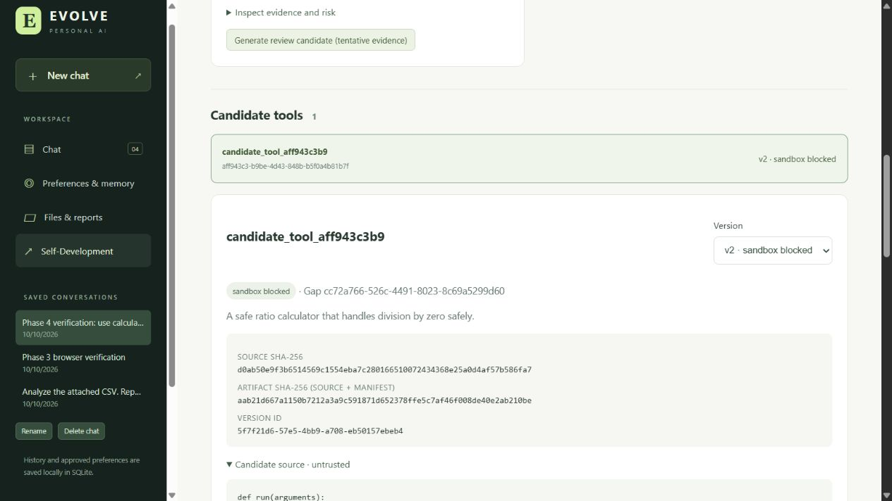

# Phase 4 implementation and validation report

Checked **10 October 2026** in `D:\evolve ai`, Windows PowerShell. **The review-only self-development foundation is implemented. Full Phase 4 runtime acceptance remains pending: this machine lacks the required OS sandbox, so no generated candidate has been executed, approved, activated or rolled back here, and no real tool improvement is claimed.** The explicit disabled-adapter fallback in the request/project brief is in effect. No next phase was started.

## Inspection and preserved foundation

Read the entire Phase 4 attachment, authoritative brief, README and previous validation report; inspected configuration, SQLite migrations, APIs, loop/activity records, registry, workspace restrictions, frontend and tests before presenting the plan and coding. Existing project is a React/Vite/TypeScript frontend, FastAPI backend, native local Ollama tool loop, five fixed tools and schema-v2 SQLite persistence. It was not rescaffolded. There is no Git repository here; none was initialized.

Baseline: **155 passed, 4 skipped, 1 warning**, 11.18 seconds. Existing dependencies/lockfiles were preserved: FastAPI 0.139.0, Uvicorn 0.41.0, HTTPX 0.28.1, Pydantic 2.12.5, pydantic-settings 2.13.1, python-dotenv 1.2.2, pandas 3.0.1, python-multipart 0.0.22 and development pytest 9.1.1; React/React DOM 19.3.0, Vite 8.3.4, TypeScript 7.0.2 and existing plugin/types. Existing local Ollama/qwen2.5:3b was used throughout. No paid APIs, extra models, runtime packages or container images were downloaded. Prettier used the existing npm development-tool workflow/cache.

Original brief SHA-256 remains `B94C88D2C1C42C11D0DF3B13DB24C275E9CB58FE35BA1FFF2B16BB614230EBD1`. Historical Phase 1–3 reports and user files remain intact.

## Architecture and files

Added `backend/app/improvement/`:

| Module | Responsibility |
| --- | --- |
| models.py | Bounded request/response models, finite JSON contract dialect, canonical artifact/source hashing |
| persistence.py | Transactional v3 DDL, candidate reservations/revisions, immutable failure artifacts and validation records |
| evaluation.py | Deterministic redacted task evaluation, explicit retry/feedback evidence, thresholded gap detection |
| generation.py | Existing real Ollama client, constrained artifact output grammar, retained generation failures |
| validation.py | Nonexecuting AST/static/style checks, human-reviewed acceptance suites, exact output checks and baseline comparisons |
| sandbox.py | Disabled-by-default opt-in Docker Desktop Linux adapter, no host-Python fallback |
| sandbox_runner.py | Trusted harness used only inside a container; never the FastAPI process |
| activation.py | Local review authorization, lifecycle/hash/test checks, atomic pointers/audit and rollback |
| runtime.py | Registry wrapper for active approved versions; dispatches through the OS sandbox only |
| api.py | Human-facing evidence/generation/contract/validation/decision endpoints |

Extended backend main/config/schemas/storage and the existing registry. The agent loop and calculator/CSV/workspace implementations are preserved. Added an optional `retry_of` request field and additive tool origin metadata; health phase/version are now 4/0.4.0. Existing response fields and Phase 1–3 workflows remain supported.

Added `backend/scripts/verify_phase4_migration.py`, `backend/tests/test_improvement.py` and `backend/tests/test_sandbox_integration.py`. Extended real inference tests, phase assertion and migration fixture; added the sandbox pytest marker. Added frontend `components/SelfDevelopment.tsx` and `lib/improvement.ts`; extended App/API/styles for navigation, explicit retries and review UX. Updated `.env.example`, README, this report and `docs/PHASE4_SECURITY.md`; added actual browser screenshots. Dependency manifests/lockfiles, `.gitignore` and existing user work were retained.

## Migration and data preservation

Schema v3 adds 12 tables for task evidence, evaluations, feedback, gaps, candidates, immutable source versions, lifecycle states, reviewed contracts, test runs, human decisions, active pointers and activation audit. Parameterized writes, foreign keys, transactions and indexes follow the existing SQLite repository. Immutable source/contracts/runs/decisions/audit have UPDATE/DELETE rejection triggers. No old table was reset/recreated.

Before modifying the live schema, SQLite's consistent backup API saved the populated v2 database as private `data/phase3-before-v3.sqlite3`, with row counts/hashes in `data/phase3-snapshot.json`. The reusable verification script migrated a disposable copy **twice**, checking exact row hashes across all seven Phase 3 tables, schema version, integrity and foreign keys. The source remained v2. Then the live app migrated to v3; all original table hashes matched exactly before any new browser verification data was added.

After the controlled browser task and restart, all original rows were still exact subsets:

| Existing table | Original rows preserved | Current rows |
| --- | ---: | ---: |
| conversations | 2 | 3 |
| tasks | 3 | 4 |
| messages | 6 | 8 |
| events | 19 | 27 |
| preferences | 1 | 1 |
| files | 3 | 3 |
| task_files | 3 | 3 |

Live integrity_check returned `ok`, foreign_key_check returned no errors, and all three original registered files still exist with their recorded sizes. The prior 812-byte JSON report downloaded successfully and matched its stored bytes exactly (SHA-256 `3453082a0fbbc921b70ccbd9b940e7f1ce0f47f094616a7aa64815b4814b0b7c`). No conversations, preferences, reports or uploads were deleted.

## Evidence, lifecycle and review

Evaluations distinguish verified calculator answers, unverified completion and failure. Correct tool data does not automatically verify model prose. Requested mode, retry linkage, duration, final-answer presence, error categories, tool-call/validation counts, verification scope and helpfulness feedback are available; legacy unknown fields remain unknown. General telemetry excludes sensitive task text, arguments/results, file data and preferences. Gaps reference actual task/event IDs, count distinct tasks, and remain tentative below configurable minimum evidence (default three). They never originate from model speculation alone.

Lifecycle is proposed → generated → validating → passed test record/awaiting_approval → approved → active, with generation_failed, validation_failed, sandbox_blocked, rejected, cancelled, inactive and superseded states. Source and manifest changes create immutable revisions. Tests and approvals bind exact version/source/artifact/suite hashes; they do not transfer. Human-reviewed independent expected outputs are required; model-suggested tests alone cannot pass validation. Valid, invalid, boundary, malformed and security cases must be present. Missing contract/isolation creates a blocked run, not a success.

Review endpoints require local Origin/Host, a custom intent header and per-process random review capability; decisions require exact hash bindings and confirmation. Models have no review tool and candidates have no database/network access through the adapter. This is a **single-user browser intent/CSRF boundary**, not multiuser login or proof that a trusted same-account process is human. See the security document for the exact trust boundary.

Only candidate-prefixed pure-JSON tools are supported. Built-ins cannot be overwritten/shadowed/replaced. Generated-version replacements must retain all baseline cases and improve an exact-output extension case. Deactivating a tool cannot bypass this requirement. Atomic pointer/state/decision/audit transactions preserve the prior active version on failure. Rollback targets a previously active approved/tested version; inactive versions retain eligibility when later revisions are created. These activation/rollback behaviors are verified with explicitly labelled **nonexecuting test doubles**, not live generated-code execution.

## Actual checks

| Check | Actual final result |
| --- | --- |
| Backend offline: `.\.venv\Scripts\python.exe -m pytest -q` from backend | **235 passed, 9 skipped, 1 warning**, 51.75 seconds |
| Real local Ollama: EVOLVE_RUN_OLLAMA_TEST=1, `-m integration -q -s` | **5 passed, 239 deselected, 1 warning**, 243.65 seconds |
| TypeScript `npm run typecheck` | Passed |
| Production `npm run build` | Passed, 22 modules, 405 ms; JS 264.54 kB (80.91 kB gzip), CSS 21.21 kB (5.51 kB gzip) |
| Ruff check on app/tests/scripts | All checks passed |
| Black check on app/tests/scripts | 36 files unchanged |
| Prettier check on frontend src | All matched files passed |
| Backend `pip check` | No broken requirements |
| npm audit `--audit-level=high` | 0 vulnerabilities at check time |
| Populated actual v2 backup → v3 copy, repeated initialization | Passed, exact seven-table hashes, source retained, integrity/FKs clean |
| Live v3 and original-data/file preservation | Passed before and after browser task/restart |
| Live health/model/tools | Phase 4 healthy, qwen2.5:3b ready; all five built-ins present with built_in origin |
| Browser console | No warnings/errors during final verified flows |

The nine offline skips are **five explicitly opt-in real Ollama tests and four OS sandbox probes**. All five Ollama tests subsequently passed in the separate real run. The four OS probes remain skipped/unrun because no reviewed Docker runtime/image is installed. They cover actual host-file/secret isolation, network denial, CPU timeout and memory limits; their passing is **not claimed**. There is no configured backend static type checker or ESLint/frontend unit runner; Ruff/Black and TypeScript/Prettier/build/browser checks were run as listed.

The existing nonblocking warning remains: Starlette TestClient deprecates HTTPX compatibility in favor of HTTPX2. It was not suppressed. Initial real candidate attempts failed because the small model omitted required schema restrictions; the output grammar was tightened while keeping validation strict, and failure diagnostics/raw-output retention were improved. A targeted real run then passed, followed by the clean five-test final run. One pytest invocation from the repository root missed the backend config/import path; it was corrected to the documented backend directory. An initial ad-hoc migration probe passed its assertions but left a SQLite connection open during temporary-directory cleanup; the reusable script closes connections and reran successfully. These were resolved; no failed check is represented as a pass.

Real final inference evidence:

- Plain chat: `2 plus 2 is 4.` (9,042 ms).
- Calculator: actual model → calculator → model cycle, verified **30 percent** (19,084 ms).
- CSV: actual tool cycle, **3 rows**, **1 missing revenue**, mean revenue **1000** (50,547 ms).
- Restart memory: recalled **MAPLE-73**, then actual create_report tool and exact downloaded content `Project code: MAPLE-73` (41,734 ms for report task).
- Phase 4: actual divide-by-zero tool failure, linked persisted gap, real generation `candidate_tool_af43898acc`, **301 source characters**, SHA-256 `fd3930e6947e3699e2c1feb5dafab0d8d3b6f6f9266f94510918c133e6d3d13d`. It remained unexecuted/unapproved in isolated test storage.

## Browser verification and retained review artifact

Used the real Vite proxy, FastAPI, local Ollama and private SQLite. A new verification conversation requested divide by zero. Its tool failed honestly; the model reported the error, and the task became completed_with_errors (30,938 ms). Dashboard shows three original unverified completions, one actual controlled failure, one tentative gap and zero active generated tools. This is deliberate test evidence, not a naturally recurring user problem or proof of improvement.

The website generated and saved this inspectable artifact:

- Task: `6c5a54d2-6da8-4146-9662-e649147a02ee`.
- Gap: `cc72a766-526c-4491-8023-8c69a5299d60` (one occurrence / three required).
- Candidate: `aff943c3-b9be-4d43-848b-b5f0a4b81b7f`, name `candidate_tool_aff943c3b9`.
- Generated version: `5f7f21d6-57e5-4bb9-a708-eb50157ebeb4`, v2.
- Source SHA-256: `d0ab50e9f3b6514569c1554eba7c280166510072434368e25a0d4af57b586fa7`.
- Artifact SHA-256: `aab21d667a1150b7212a3a9c591871d652378ffe5c7af46f008de40e2ab210be`.
- Validation: `7c03cf88-2b6f-4fcd-92f6-cbe15e609a58`, **blocked**, no static findings, no executable test results, no human-reviewed suite, unavailable sandbox.

The candidate proposes a ratio result with a separate defined flag for zero denominators. Its source is not assumed correct and has not run. The website displays actual source/manifest/hashes/run/lifecycle. Approve/activate/rollback remain disabled; opening and cancelling rejection showed exact IDs/hashes and did not record a decision. Backend restart and browser reload preserved the artifact and validation. Live database confirms **zero approvals and zero active generated versions**.

Verified old conversation/preference/files views and an exact report download after restart. Checked default desktop and 390×844 mobile; document width was 375 px, within the viewport, including the candidate inspector/hashes. Mobile navigation and wrapped confirmation text worked. Restored the default viewport. Saved screenshots:





Mobile evidence: [candidate](docs/phase4-candidate-mobile.png), [exact-hash confirmation](docs/phase4-confirmation-mobile.png). Reproduction steps and the complete review workflow are in [docs/PHASE4_SECURITY.md](docs/PHASE4_SECURITY.md).

## Sandbox and outstanding acceptance

The adapter is opt-in **Docker Desktop Linux** with a reviewed pre-existing immutable image ID, local named-pipe context, seccomp, no network, no host secrets/data/database mounts, read-only image/one per-run fixture mount, unprivileged UID, dropped capabilities, no-new-privileges, tmpfs output, CPU/memory/process/file/output limits, captured results and timeout cleanup. `--pull=never` prevents downloads. It never falls back to Windows/WSL Python execution. Exact requirements, commands and security limits are documented in [PHASE4_SECURITY.md](docs/PHASE4_SECURITY.md).

Docker/Podman are absent. WSL2 Ubuntu alone does not satisfy isolation. Therefore current runtime status is safely disabled, and actual container isolation has not been validated. Containers share the Linux VM kernel; this is not an audited malware sandbox. Same-account OS processes and the reviewed runtime image/daemon remain trusted.

| Acceptance area | Status |
| --- | --- |
| Actual task evidence → inspectable gap | Passed, including real browser/Ollama failure and tentative threshold |
| Real local candidate generation | Passed, offline fixtures and real inference reported separately |
| Reproducible persisted validation | Static/blocked records passed; executable correctness awaits OS sandbox + human suite |
| Isolation | Safe disabled fallback implemented; live OS isolation pending |
| Source/hash/tests/lifecycle UI | Passed, responsive browser/restart verification |
| Exact-hash approval and source-change invalidation | Backend enforced and offline tested; no live approval performed |
| Atomic failure/rollback | Offline tested with nonexecuting fixture adapter; live sandbox execution pending |
| Existing features/data | Preserved; original rows/files, regressions and actual inference/downloads checked |
| Offline/frontend/quality checks | Passed |
| Demonstrated real tool improvement | **Pending; no claim of improvement** |

Recommended next step within Phase 4: an operator provides/reviews a suitable existing local OS sandbox/runtime image, runs all four actual isolation probes, then a human independently reviews a deterministic acceptance suite. Only after successful isolated tests and measurable replacement comparison may the human approve the exact hashes and separately confirm activation/rollback. No software/model installation or live approval was performed on the user's behalf.

## Windows PowerShell startup

Use the existing Ollama installation; `ollama list` must show qwen2.5:3b. If Ollama is already running, keep it running. Otherwise open its app or run `ollama serve` separately. Do not pull a model.

Backend terminal:

```powershell
Set-Location 'D:\evolve ai\backend'
.\.venv\Scripts\python.exe -m uvicorn app.main:app --host 127.0.0.1 --port 8000
```

Frontend terminal:

```powershell
Set-Location 'D:\evolve ai\frontend'
npm run dev
```

Open http://127.0.0.1:5173. Both development servers were left running for review; avoid starting duplicate copies on occupied ports. Keep one backend worker and SANDBOX_ENABLED=false. Fresh dependency setup, backup/restore and configuration instructions remain in [README.md](README.md). Preserve data/ and workspace/ when upgrading.
