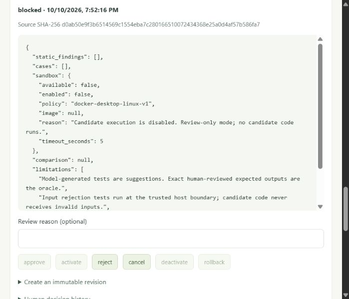

# Phase 4 automatic tool-building audit

Audit date: **10 October 2026**, `D:\evolve ai`, Windows PowerShell. This report supersedes assumptions about operational readiness; historical implementation reports remain unchanged.

## Executive summary

**EVOLVE generates real candidate tools, but the complete automatic tool-building lifecycle is not operational on this machine.** Actual persisted failures produce inspectable tentative gaps; the existing local `qwen2.5:3b` generated a fresh nonempty artifact during this audit. Source/manifest hashes reproduce, versions persist, and the website accurately displays a blocked validation and disabled approval/activation controls.

**Isolated execution, executable correctness, live generated-tool activation/rollback and measurable improvement are BLOCKED.** Docker and Podman are absent, sandbox execution is disabled, no reviewed runtime image is configured, and no independent human-approved acceptance suite exists. No candidate Python was executed and no real candidate was approved, activated, deactivated or rolled back. Nothing was installed or downloaded; the model was not changed. No other project phase was started.

Two malformed-result defects were reproduced with nonexecuting fixtures and fixed narrowly: validation/runtime could raise uncaught AttributeError; malformed baseline items could be reported as improvement. Eight new audit regressions pass. These fixes establish failure handling, not live OS isolation.

The audit also found a generation-quality limitation: the fresh model artifact suggests only two cases, both mislabeled security, with no invalid-input case. The independent contract gate rejects that as an acceptance suite. Generation success must not be presented as correctness success.

## Lifecycle and direct-evidence classification

```text
actual tool failure -> persisted task/events -> deterministic evaluation/gap
 -> explicit local generation request -> immutable source/manifest/hashes
 -> nonexecuting manifest + AST checks -> human reviews independent suite
 -> VERIFIED OS SANDBOX [BLOCKED HERE] -> exact outputs + baseline comparison
 -> immutable passing run -> exact-version human approval -> atomic activation
 -> normal agent loop invokes sandbox -> separately confirmed rollback
```

Gap evaluation is automatic after tasks and on startup/refresh. Candidate generation requires an explicit request; there is no autonomous background build/deploy loop. PASS below means direct evidence of the named stage, not an endpoint's existence. Fixture evidence is separately qualified and does not make a real-code stage PASS.

| # | Lifecycle stage | Status | Responsible source/functions and direct evidence |
|---|---|---|---|
| 1 | Observe a real tool failure | **PASS** | `app/agent/loop.py:AgentLoop._run/record`, `tools/calculator.py:calculate`. Live task `6c5a54d2-6da8-4146-9662-e649147a02ee` has division_by_zero at event 5. This audit's isolated real inference reproduced it in task `8e3b93c9-21c9-4b7e-8688-f948d303346f`. |
| 2 | Persist task evidence/events | **PASS** | `app/main.py:chat`, `storage.py:Database.begin/event/finish`, `Evaluator.record_request/record_error/refresh`. Read-only SQL and GET task/snapshot show actual references, duration and completed_with_errors. |
| 3 | Detect an evidence-backed gap | **PASS** | `improvement/evaluation.py:Evaluator.gaps`. Original gap `cc72a766-526c-4491-8023-8c69a5299d60` links the actual failure; one occurrence / three required is correctly tentative. Threshold logic also tested offline. |
| 4 | Generate with configured local Ollama | **PASS** | `generation.py:generate`, `api.py:candidate`, `Repository.proposed/append/generation_failure`. Fresh real artifact `candidate_tool_1893a0a610`; complete accepted response, 301 source characters, independently reproduced hashes. No mock transport in real inference tests. |
| 5 | Validate manifest/source structure | **PASS** | `models.py:Manifest.contract/schema_check`, `validation.py:static_checks`. Fresh artifact parses, uses supported object schemas and has no static findings. This establishes structure only; generated test coverage fails the independent-suite requirements. |
| 6 | Obtain independent human-reviewed suite | **BLOCKED** | `Validator.contract`, POST `/improvement/contract`, frontend human-review checkbox. Eleven independent cases prepared below; **draft, not human-reviewed or submitted**. Category/hash/immutability gates verified in disposable fixtures. |
| 7 | Execute only in verified OS sandbox | **BLOCKED** | `sandbox.py:DockerSandbox.status/command/run`, container-only `sandbox_runner.py:main`. Actual available=false, enabled=false, image=null; Docker/Podman missing. Disabled adapter refusal is directly/offline demonstrated, OS isolation is not. |
| 8 | Persist actual candidate execution/limits/results | **BLOCKED** | `Validator.validate`, `Repository.save_run`. Actual existing blocked run persists and survives restart. Successful executions, timeouts and resource failures have **fixture-only** coverage, not real container evidence. |
| 9 | Prove deterministic correctness/baseline improvement | **BLOCKED** | `Validator.validate/compare`, `models.py:value_check/digest`. Exact-output and replacement rules tested with nonexecuting fixtures. No real execution/comparison. Malformed-baseline defect fixed; no improvement claimed. |
| 10 | Invalidate tests/approval on relevant changes | **NOT TESTED** for real tested code | `Repository.append/bound`, immutable SQL triggers, `Activation.tested/approved`. Source-only and manifest-only revisions, suite-hash mismatch and trigger rejection pass **disposable fixture tests**. No live tested/approved candidate exists to revise. |
| 11 | Human approves exact tested version/hashes | **BLOCKED** | `activation.py:review_origin/authorize/Activation.decide/tested/approved`; POST `/improvement/decision`. Live approvals zero. Missing/forged authorization and wrong hashes rejected in offline tests; live UI approve disabled. |
| 12 | Activate atomically, preserve working baseline | **BLOCKED** | `Activation.decide` transaction over pointer/state/decision/audit. Deliberate audit-insert SQL failure rolls back in a disposable fixture; not a real generated-code activation demonstration. |
| 13 | Execute approved tool in normal agent loop | **BLOCKED** | `runtime.py:generated_specs/GeneratedSpec.implementation`, `ToolRegistry.__init__/validate/execute`, `AgentLoop._run`. Live GET `/tools` exposes only five built-ins. Unapproved direct wrapper call rejected before adapter use in audit test. No active generated tool. |
| 14 | Roll back real approved/tested version | **BLOCKED** | `Activation.decide(action=rollback)/executable`. Prior-activation/approval/test checks and before/after audit verified with nonexecuting fixtures only. Live rollback audit empty. |

Additional observed **FAIL** findings and their resolutions are listed under Defects. The complete feature remains blocked even though structural and fixture tests pass.

## Inspected architecture and endpoints

Read all ten improvement modules, sandbox harness, registry, full agent loop, main/config/storage/schema handling, existing Phase 4 tests, frontend component/API client, README, project brief and security documentation. `app/improvement/` separates models, persistence, evaluation, generation, validation, sandbox, activation and runtime. Host executable calls are confined to the Docker CLI adapter; the candidate import appears only in the container harness. No host Python execution fallback was found.

Relevant routes are GET `/improvement`, POST `/improvement/refresh`, POST `/improvement/candidates`, GET `/improvement/candidates/{id}`, POST `.../{id}/versions`, POST `/improvement/contract`, `/validate`, `/decision`, `/review-session`, and `/feedback/{task_id}`. None is in the model tool registry. Browser `/api` proxy strips its prefix. Review mutations use `authorize` and idle checks; generation/validation use the existing chat lock. Review-origin/session gates and lifecycle gates are enforced in the backend, independently of disabled UI buttons.

Generation receives only redacted capability/error/count, not original prompts, file data or preferences. Gap detection groups failure categories and explicit negative feedback; it does not infer every missing capability from otherwise successful prose. Calculator verification is narrow; completion alone remains unverified. Lists are bounded to 200. These are practical coverage limits, not general intelligence or correctness guarantees.

## Current SQLite and preservation evidence

Read-only `mode=ro` SQL confirmed schema **3**, 19 application tables, ten immutable UPDATE/DELETE triggers, `integrity_check=ok`, and no foreign-key errors. At audit entry: four conversations, four tasks, eight messages, 27 events, one preference, three files, three task-file links, one gap, one candidate, two versions, one blocked run, zero contracts/decisions/active tools/activation audit. A fourth empty conversation existed before the audit; it was preserved.

Private `data/phase4-audit-before.json` records per-table counts/hashes without copying private text to this report. After restart, exact hashes verified all original tasks/messages/events/evidence and **all** candidate/version/state/run/review/registry/preference/file/link records. All registered files exist with matching recorded sizes. No candidate record was changed for this audit. Existing candidate v2 source hash remains `d0ab50e9f3b6514569c1554eba7c280166510072434368e25a0d4af57b586fa7`, artifact hash `aab21d667a1150b7212a3a9c591871d652378ffe5c7af46f008de40e2ab210be`; its blocked run remains `7c03cf88-2b6f-4fcd-92f6-cbe15e609a58`.

**Audit interruption:** a new chat task started concurrently after the entry snapshot. The audit restarted the backend without a sufficiently recent running-task check, interrupting task `d23b9f6a-eeee-484b-aed8-2fce1ae173e6`. Startup correctly retained its message/events and marked it interrupted; it was not replayed or deleted. This is an audit-operation mistake, not a generated-tool failure or improvement demonstration. The affected conversation updated, and startup refreshed evaluation timestamps and added its honest failure/gap. An initial whole-database equality assertion therefore failed; filtered comparisons confirmed every pre-existing task/message/event and all protected records remained unchanged. Current counts are five tasks/nine messages/29 events/two gaps; dashboard failure count increased from one to two. No claim that the entire database was byte-identical after restart is made.

The existing populated v2 backup was independently migrated twice on a temporary copy using `scripts/verify_phase4_migration.py`: all seven Phase 3 tables retained exact row hashes, integrity/FKs clean, source remained v2. This corroborates migration preservation without re-migrating/resetting live v3 data.

## Fresh real candidate-generation evidence

The five real integration tests use autouse `tests/conftest.py:isolated_private_storage` to select temporary data/workspace directories. No real-inference test writes the user's DB. Fresh candidate evidence was exported **read-only** from the test DB to [phase4-audit-generation.json](phase4-audit-generation.json), including full source/manifest, real gap/event refs, hashes and the draft suite. This exported JSON is review data, not an execution result or production candidate insertion.

- Model: existing **qwen2.5:3b**, local Ollama only.
- Candidate: `1893a0a6-10f0-4398-8b85-8e09467f365d`, tool `candidate_tool_1893a0a610`.
- Version: v2, `f9dc2cdf-9bb5-48e9-bb88-2d253522766f` (v1 retains the proposal reservation).
- Source: 301 characters, complete `run(arguments)` function, zero AST findings, no imports/dependencies, pure_json only, replaces=null.
- Source SHA-256: `fd3930e6947e3699e2c1feb5dafab0d8d3b6f6f9266f94510918c133e6d3d13d`.
- Artifact SHA-256: `46331f3bb6105f11369b293e8ca3c6ea80429e3dec77930eb2cf815ace0b377f`.
- Independently computed manifest SHA-256: `8c99a22856d7f58825f8bfac3440632ccab160a9c93970c27edb3cc57e295656` (diagnostic; production binds the whole artifact).

Manifest/source agree structurally on numerator/denominator inputs and quotient/defined outputs, with strict object keys. Source branches on zero denominator, returns quotient=0/defined=false for undefined division, otherwise quotient/defined=true. **This semantic reading was not verified by executing the source.** Numeric schemas have no magnitude bounds, so extreme finite operands could overflow. That remains a candidate review issue, not a passing correctness result.

Both suggested cases have category security and reject=false; they use ordinary accepted numeric inputs. There is no invalid-input example, and the zero-divisor boundary is mislabeled. Their integer expected quotient 5 also differs under exact JSON hashing from Python division's floating 5.0. Pydantic Artifact accepts suggestions, but `Validator.contract` requires all five categories and true schema rejection for invalid/malformed/security. Do not copy these suggestions into approval unchanged.

`generate` rejects incomplete/done=false/length-limited responses and invalid artifact/schema JSON, retaining a generation_failed record and bounded raw output when available. Offline tests exercise unavailable, malformed, truncated and hostile-but-stored responses; these are labelled transport fixtures, not additional actual model failures during this audit. The actual successful response has a parsed complete artifact and reproducible stored hashes; successful syntax does not imply correct code.

## Independent acceptance-suite draft

Problem: a separate ratio tool could represent undefined division explicitly rather than returning a mathematical quotient for a zero divisor. It does not replace or alter calculate. Existing calculate intentionally rejects division by zero, which is correct for its contract; observing that failure does not itself prove a missing tool or user benefit.

The audit independently specified these expected results **without deriving an oracle by running the generated tool**. Full normalized cases and canonical suite hash are in the exported JSON.

| Category | Input | Independent expected outcome |
|---|---|---|
| valid | numerator=10, denominator=2 | quotient=5.0, defined=true |
| valid | numerator=3, denominator=2 | quotient=1.5, defined=true |
| valid | numerator=-9, denominator=3 | quotient=-3.0, defined=true |
| boundary | numerator=0, denominator=5 | quotient=0.0, defined=true |
| boundary | numerator=7, denominator=0 | quotient=0, defined=false |
| boundary | numerator=0, denominator=0 | quotient=0, defined=false |
| invalid | Boolean numerator | Host input-schema rejection |
| invalid | Numeric-string numerator | Host input-schema rejection |
| invalid | Missing denominator | Host input-schema rejection |
| malformed | Array instead of argument object | Host input-schema rejection |
| security | Extra path=../../.env and command=whoami fields | Host rejects undeclared fields; no command is run |

Draft suite SHA-256: `5a4f0f2847929709bd5aa6b0e9aac368e88320395bb569b652cef5d74d75b963`. All eleven cases' schema acceptance/rejection and expected-output schemas were checked on the trusted host. Those are **schema checks only**. Isolated candidate outputs=null; measurable improvement=null. The suite is **not human-reviewed, not submitted as a reviewed contract, and BLOCKED** until the user reviews it and an OS sandbox is verified. No automated checkbox/approval was fabricated.

For this new separate tool there is no approved generated baseline. Any benefit claim must specify a user task/metric and demonstrate it; six exact accepted-output cases and five host-rejection cases are only a proposed acceptance threshold, not evidence of improvement. A replacement must retain every earlier contract case and pass an added case where its approved baseline fails, using the same sandbox inputs. Extreme-number behavior needs domain restriction or an independently specified overflow contract before claiming broad numeric correctness.

## Hashes, immutability and authorization

- `models.digest`: SHA-256 of exact UTF-8 source; canonical sorted compact JSON with allow_nan=false for manifest+source and normalized case lists. Formatting/line endings change source hash. Manifest-only edits change artifact hash even if source hash remains constant. Exact comparison distinguishes 5 from 5.0.
- `Repository.append`: appends immutable version UUID/number, enforces same candidate name/ownership and latest base. New revision has no run/contract/approval. Old active version can continue until replaced; historical inactive approved versions remain rollback candidates.
- `Repository.bound`: checks exact version/source/artifact bindings, recomputes hashes, enforces latest version except rollback/deactivation. Version UUID resolves its candidate; candidate ID is not a separate DecisionInput field.
- `Validator.contract`: independent five-category suite, unique labels, input/output checks, immutable single contract per version. Contract changes require a revision. Suggested tests are part of manifest/artifact hashing; reviewed contract has a separate suite hash.
- `Activation.tested/approved`: latest passing run must match version/source/artifact/reviewed suite and current available sandbox policy/image; latest relevant decision must approve exact source/artifact. Suite-hash mismatch blocks approval. SQL immutable triggers reject source/contract/run/decision/audit edits through ordinary application access.
- Review boundary: exact local Origin/Host, intent header and random per-process session capability; confirm=true required. The UI displays exact IDs/hashes and separates approval from activation. Session expires on restart. **This is local browser intent/CSRF protection, not multiuser authentication or proof a same-account OS process is human.** Same-user processes, DB owner, local daemon and runtime image are trusted.
- No model-facing approval tools or arbitrary HTTP/shell tools exist. Generated tool names must start candidate_; built-in names/replacements are rejected. Fixture tests verify forged/missing credentials, all six actions, revision invalidation, atomic audit-insert failure, prior-version rollback and the immutable triggers.

## Sandbox architecture and actual isolation evidence

Actual configuration: available=false, enabled=false (SANDBOX_ENABLED=false), SANDBOX_IMAGE empty, policy docker-desktop-linux-v1, five-second deadline. `Get-Command` finds Ollama but neither docker nor podman. No sandbox was enabled or substituted; no container/image/model/dependency download occurred.

Code inspection and offline command fixtures establish the intended adapter configuration:

- Fixed local `desktop-linux` context, named-pipe endpoint only; Linux daemon with seccomp, Linux image, exact pre-existing sha256 image ID, no image-declared volumes, standard runtime environment keys only. Tags and mismatched image identity are rejected; --pull=never prevents pulling.
- Unprivileged UID/GID 65534, network none, read-only root, all capabilities dropped, no-new-privileges, PID cap 32, 256 MiB memory/no extra swap, one CPU, fd/file limits, IPC none, logging disabled, healthcheck disabled.
- Only one fresh read-only fixture directory is mounted, containing candidate source, trusted harness and inputs. No project, user home, workspace, database, credentials, Docker socket or other candidate directory mount. Expected outputs are not staged. Host CLI gets filtered OS/path/profile/temp variables; these are not passed into the container. Reviewed image environment remains trusted.
- Dedicated 8 MiB noexec/nosuid/nodev tmpfs output. Container harness sets CPU=3s, address-space=240MiB, file=1MiB/core=0 limits; bounded candidate stdout/stderr. Host caps each stream at 32KiB, records exit/time/timeout/overflow/policy/image and validates bounded JSON shape.
- Wall timeout/overflow kills the CLI and explicitly removes the named container; cleanup failure disables further adapters for the backend process. Temp staging is removed. No fallback to host/WSL Python exists. The only candidate import is `/fixture/candidate.py` inside the container harness.

**Actual OS isolation evidence: NONE.** The four opt-in probes (host-file/secret isolation, network denial, CPU timeout, memory bound) were skipped/unrun because required infrastructure is absent. Static malicious-source flags and command/subprocess mocks are not substitutes. Malformed output handling now has regression coverage; actual Docker crash/timeout/cleanup behavior remains unverified. Exit code is recorded, but fine-grained Docker OOM/CPU termination attribution is not implemented.

An image ID is immutable, **not proof of review**. There is no signed image-review allowlist/attestation; choosing a reviewed secret-free runtime is an operator prerequisite. Standard environment key names alone do not prove their values contain no secrets. Containers share the Linux VM kernel and trust the daemon/image; they are not an audited malware sandbox. Full commands/policy/trust limits are in [PHASE4_SECURITY.md](PHASE4_SECURITY.md).

## Actual commands and results

Commands used existing runtimes/packages; no installation commands were run.

```powershell
Set-Location 'D:\evolve ai\backend'
.\.venv\Scripts\python.exe -m pytest -q
$env:EVOLVE_RUN_OLLAMA_TEST='1'
.\.venv\Scripts\python.exe -m pytest -q -s -m integration
Remove-Item Env:EVOLVE_RUN_OLLAMA_TEST
python -m ruff check app tests scripts
python -m black --check app tests scripts
.\.venv\Scripts\python.exe -m pip check

Set-Location 'D:\evolve ai\frontend'
npm run typecheck
npm run build
node 'C:\Users\sneha\AppData\Local\npm-cache\_npx\b388654678d519d9\node_modules\prettier\bin\prettier.cjs' --check src
npm audit --audit-level=high

Set-Location 'D:\evolve ai'
backend\.venv\Scripts\python.exe backend/scripts/verify_phase4_migration.py data/phase3-before-v3.sqlite3
```

| Actual run | Output/result |
|---|---|
| Initial unchanged offline suite | **235 passed, 9 skipped, 1 warning in 27.40s** |
| Audit malformed-item regressions before fix | **5 failed, 2 passed, 1 warning in 10.46s**; uncaught AttributeError reproduced |
| Added malformed-baseline regression before fix | **1 failed, 7 deselected, 1 warning in 8.20s**; run incorrectly passed |
| Eight audit regressions after fixes | **8 passed, 1 warning in 30.94s** |
| Full offline suite after fixes | **243 passed, 9 skipped, 1 warning in 80.18s** |
| Fixture import/lint cleanup focused rerun | **8 passed, 1 warning in 3.94s**, Ruff passed, Black 38 files unchanged |
| Separate real local Ollama suite | **5 passed, 239 deselected, 1 warning in 316.87s** |
| TypeScript | Passed |
| Production build | Passed, 22 modules, 437ms; JS 264.54kB / gzip 80.91kB; CSS 21.21kB / gzip 5.51kB |
| Prettier cached CLI | All matched files use Prettier code style |
| Ruff final | All checks passed |
| Black final | 38 files unchanged |
| pip check | No broken requirements found |
| npm audit | Found 0 vulnerabilities at check time |
| Populated v2 copy migration twice | passed, source_retained_v2=true, exact seven-table hashes |
| Live health/model/tools | 200, phase4 healthy, qwen2.5:3b ready, five built-ins only |
| Real browser report download | Exact 812-byte match, SHA256 3453082a0fbbc921b70ccbd9b940e7f1ce0f47f094616a7aa64815b4814b0b7c |
| Final browser warn/error logs | Empty |

Nine offline skips: five explicitly opt-in Ollama tests (subsequently all ran/passed separately) and **four OS sandbox probes that remain unrun**. No backend static type checker, ESLint script or frontend unit runner is configured; none is claimed. Existing warning: StarletteDeprecationWarning about HTTPX TestClient compatibility recommending HTTPX2; no package was added or warning suppressed.

The real suite started after the initial offline suite and imported the pre-audit modules before the defensive result fixes/new tests were added. It therefore reports 239 deselected; it demonstrates current unchanged generation/chat/built-in behavior, not new sandbox fixes. The final offline suite exercises the fixes. Real model outputs: plain `2 plus 2 is 4.` (23,101ms); calculator actual profit margin 30.0% (22,119ms); CSV actual three rows/one missing revenue/mean1000/no duplicates (43,279ms); restart recalled MAPLE-73; actual report downloaded `Project code: MAPLE-73` (56,191ms). The model's report prose rendered a malformed-looking download URL, while the actual tool result's download handle worked; model prose is not treated as the oracle.

Fresh artifact export command (temporary test path is machine/run specific):

```powershell
Set-Location 'D:\evolve ai\backend'
.\.venv\Scripts\python.exe scripts/audit_phase4_artifact.py 'C:\Users\sneha\AppData\Local\Temp\pytest-of-sneha\pytest-31\test_real_candidate_generation0\data\evolve.sqlite3' '..\docs\phase4-audit-generation.json'
```

Output: source_hash_reproduced=true, artifact_hash_reproduced=true, static_findings=[], suggested_case_categories=[security,security], eleven DRAFT cases, UNREVIEWED/UNEXECUTED. Temp test directories may expire; the exported evidence remains. The script reads SQLite mode=ro, never executes source and never writes a reviewed contract or approval.

## Defects, fixes and remaining limitations

1. **FAIL, fixed: malformed runner item.** Adapter decoding accepted any results list; Validator and GeneratedSpec assumed each item was a dict. Null/scalar/list/string items caused AttributeError, no persisted failed run and a version left validating. Added Docker result-item shape checks, defensive validator/runtime guards and four malformed-item regressions plus runtime regression. No source executes in these fixtures.
2. **FAIL, fixed: malformed baseline claimed improvement.** A malformed baseline list could become zero passes, yielding improved=true and a passing candidate run. `Validator.compare` now treats malformed result structure as inconclusive failure. Dedicated regression preserves the prior active fixture version. No actual measurable gain is claimed.
3. **FAIL, retained candidate-quality finding:** model suggestions omit independent invalid/boundary coverage and misuse categories; accepted numeric domain permits overflow. Existing candidate/source was intentionally not edited. Independent review/contract and actual isolated outputs remain required.
4. **Coverage limit:** eight new tests and existing activation/rollback tests use explicitly labelled test-only-no-execution adapters. Test data never enters the production DB; source is compared/stored as text. No UI success states/mock production executor were added. Actual whole agent-loop use of a real approved generated version remains blocked.
5. **Operational audit mistake:** concurrent chat interrupted by backend restart, acknowledged above. Future restart verification must wait for all running tasks to finish immediately before stopping; do not replay side effects automatically.
6. One interim Ruff run found fixture-import F811 redefinitions in the new audit tests; replaced the fixture import with a normal local disposable fixture. Final Ruff/Black and focused tests pass. An inspection command initially used the wrong agent-loop path and a Windows glob unsupported by rg; corrected to `app/agent/loop.py` and `rg ... -g '*.py'`. Neither was a feature/test success claim.

Modified application files only: `backend/app/improvement/sandbox.py`, `validation.py`, `runtime.py` (malformed-output guards). Added `backend/tests/test_improvement_audit.py`, `backend/scripts/audit_phase4_artifact.py`, this report, exported JSON and audit screenshots. No dependencies, lockfiles, model configuration, migrations, core tools or approval policy were changed.

## Real UI verification

Used existing browser at http://127.0.0.1:5173, real Vite proxy/FastAPI/Ollama. Inspected actual candidate list, source/manifest/source+artifact hashes and existing blocked run. Approve, activate and rollback disabled; test payload explicitly has cases=[] and sandbox.available=false. No live validation/rejection/approval was submitted. Reopened the same candidate after backend restart (PID15328) and browser reload: identifiers/source/hashes/run unchanged, per-process review session renewed through the existing client.

Existing saved chat history rendered. Preferences page retained its approved preference with unchecked save box. Files/reports showed available registered files and preserved task history. Downloaded the existing JSON through the browser and compared exact stored bytes. Actual new inference/chat/calculator/CSV/memory/report workflows were separately exercised in temporary integration storage. Final browser warn/error logs empty. No hardcoded success UI or fake metrics inserted.



[Full candidate/dashboard screenshot after restart](phase4-audit-candidate.png). Metrics include the separately documented interrupted concurrent task; they are backend records, not invented test successes.

## Unblocking steps and final verdict

Do not enable execution just to make a demonstration pass. No enabling/install/image-pull action was taken.

1. With explicit user authorization for any required installation, an operator must supply a suitable already-present Docker Desktop Linux runtime and independently reviewed secret-free Python image pinned to its actual local sha256 ID. Review the adapter/trust model and laptop resources first. A tag or ordinary WSL subprocess is insufficient.
2. Follow [PHASE4_SECURITY.md](PHASE4_SECURITY.md) read-only prerequisite checks. After explicit authorization to enable sandbox configuration, configure the reviewed image and opt-in flag; restart only when no tasks are running. Actual environment must pass all four opt-in probes:

   ```powershell
   Set-Location 'D:\evolve ai\backend'
   $env:EVOLVE_RUN_SANDBOX_TEST='1'
   .\.venv\Scripts\python.exe -m pytest -q -m sandbox
   Remove-Item Env:EVOLVE_RUN_SANDBOX_TEST
   ```

3. A human must independently review candidate source/manifest/domain and acceptance cases, revising the candidate when needed. Submit the reviewed suite explicitly, run isolated validation, inspect exact outputs/resources/security limitations. For a replacement, retain baseline tests and demonstrate an extension gain. No passing syntax/exit code substitutes for this.
4. Only the human may approve the exact tested version/hashes, separately confirm activation, demonstrate its use through the real agent loop, then confirm rollback to a previously active tested/approved version. Use disposable installation data first and inspect the actual audit history.

| Final question | Verdict |
|---|---|
| Can EVOLVE generate candidate tools? | **Yes.** Fresh real local generation and persisted reproducible artifacts demonstrated. |
| Can it safely execute them on this machine now? | **No. BLOCKED.** Required verified OS sandbox missing; execution correctly disabled. |
| Can it prove correctness of this generated candidate now? | **No. BLOCKED.** Structural/schema checks pass, but no isolated candidate outputs or human-reviewed contract. Finite test cases would establish only their defined scope. |
| Can it activate and roll back a real generated tool now? | **Not demonstrated; BLOCKED.** Lifecycle logic passes nonexecuting fixture tests, live prerequisites/approval absent. |
| Has an actual tool improvement been demonstrated? | **No.** No real candidate/baseline execution, task benefit or approved lifecycle demonstration. |

**Final verdict: functional local candidate generation and safe review-only blocking; not a fully operational automatic tool-building/self-improvement engine.** Stop at the sandbox and human-review boundaries. No next phase.
